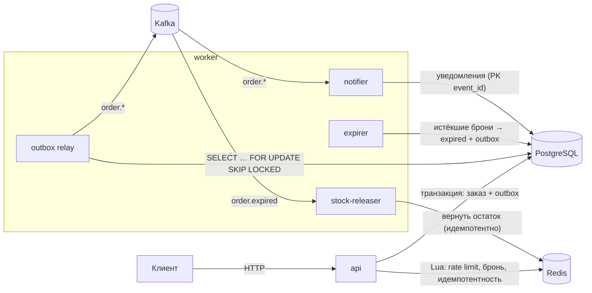

# flashsale


Сервис бронирования товара на флеш-распродаже на Go. Тысячи покупателей одновременно пытаются купить ограниченный товар. Сервис продаёт **ровно** столько единиц, сколько есть: без оверселла и без двойных покупок одним пользователем, при любой конкурентности.

**Стек:** Go 1.24 · PostgreSQL 16 · Redis 7 · Kafka (KRaft) · Prometheus · Docker Compose · GitHub Actions

## Результат нагрузочного теста

10 000 покупателей отправляют 20 000 запросов на 100 единиц товара (`make loadtest`):

```
duration: 1.566s, throughput: 12769 req/s
latency p50=11.5ms p95=27.2ms p99=60.1ms
responses:
  201 Created: 100
  409 Conflict: 19900
reservations created: 100, postgres reserved: 100, redis available: 0
OK: sold exactly the available stock, no oversell
```

Замер сделан на 2 vCPU, генератор нагрузки работал на той же машине, что и сервис, Postgres и Redis.

## Архитектура



### Как проходит бронь

1. **Rate limit** в Redis: не больше N попыток в секунду на пользователя (атомарный Lua `INCR`+`EXPIRE`).
2. **Idempotency-Key**: повтор запроса с тем же ключом вернёт тот же ответ и не создаст второй заказ.
3. **Lua-скрипт в Redis** атомарно проверяет, что распродажа началась, что у пользователя ещё нет брони и что товар есть, затем списывает единицу. Здесь отсекается 99% запросов, и до базы они не доходят.
4. **Транзакция в PostgreSQL** (только для «победителей», их не больше, чем товара):
   `UPDATE sales SET reserved = reserved + 1 WHERE reserved < total_stock` → `INSERT order` → `INSERT outbox`.
5. Если запись в базу упала, выполняется **компенсация**: единица возвращается в Redis.

Дальше всё асинхронно:

- **Outbox relay** публикует события в Kafka.
- **Expirer** переводит неоплаченные брони в `expired`.
- **stock-releaser** по событию `order.expired` возвращает товар в Redis.
- **notifier** отправляет уведомления.

## Ключевые решения

| Проблема | Решение |
|---|---|
| Гонка «проверить остаток → списать» | Lua-скрипт в Redis выполняется атомарно, между проверкой и списанием никто не вклинится |
| Redis — кэш, он может ошибиться или потерять данные | **PostgreSQL — источник истины**: `CHECK (reserved <= total_stock)` и частичный уникальный индекс `(sale_id, user_id) WHERE status IN ('reserved','paid')`. Даже без Redis база не даст продать лишнее (покрыто интеграционным тестом) |
| Redis перезапустился без данных | Самовосстановление: если Lua вернул «не загружено», сервис восстанавливает остаток и список покупателей из Postgres (`InitIfAbsent`, без гонок между инстансами) |
| Событие в Kafka может потеряться или появиться без изменения в БД (dual write) | **Transactional outbox**: событие пишется в той же транзакции, что и заказ, relay публикует его отдельно |
| Несколько relay/expirer одновременно | `FOR UPDATE SKIP LOCKED`: каждый экземпляр берёт свою пачку строк |
| Kafka доставляет at-least-once, сообщения могут дублироваться | Идемпотентные потребители: маркер `released:{order_id}` в Redis (`SET NX`) и `PRIMARY KEY (event_id)` в таблице уведомлений |
| Порядок событий одного заказа | Ключ сообщения = `order_id`, все события заказа попадают в одну партицию |
| «Ядовитое» сообщение блокирует партицию | Ретраи с экспоненциальным backoff, затем DLQ-топик `order-events.dlq`. Offset коммитится только после обработки или записи в DLQ |
| Гонка «оплата vs истечение брони» | Оба делают `UPDATE` одной строки с условием на статус и время; PostgreSQL сериализует их построчной блокировкой |
| Сетевой сбой → клиент повторяет запрос | `Idempotency-Key`: ответ сохраняется в Redis. 5xx не сохраняется, чтобы клиент мог повторить |
| Redis Cluster и Lua с несколькими ключами | Hash tags `{sale:ID}`: все ключи распродажи попадают в один слот |
| Остановка контейнера посреди запроса | Graceful shutdown через `signal.NotifyContext`: сервер дожидается текущих запросов, воркеры завершают работу по `context` |

## API

Пользователь передаётся заголовком `X-User-ID`. В реальной системе его подставляет API Gateway после проверки токена.

```bash
# создать распродажу
curl -X POST localhost:8080/api/v1/sales \
  -d '{"name":"iPhone drop","total_stock":100}'

# забронировать (повторяйте с тем же Idempotency-Key — получите тот же ответ)
curl -X POST localhost:8080/api/v1/sales/1/reservations \
  -H 'X-User-ID: 42' -H 'Idempotency-Key: 3f1c...'

# оплатить
curl -X POST localhost:8080/api/v1/orders/1/pay -H 'X-User-ID: 42'

# состояние распродажи и заказа
curl localhost:8080/api/v1/sales/1
curl localhost:8080/api/v1/orders/1 -H 'X-User-ID: 42'

# health / readiness (проверяет Postgres и Redis)
curl localhost:8080/healthz
curl localhost:8080/readyz
```

| Код | Когда |
|---|---|
| `201` | бронь создана |
| `409 sold_out` / `already_reserved` / `sale_not_started` / `order_not_payable` | бизнес-отказ |
| `429 rate_limited` | слишком частые запросы (`Retry-After: 1`) |
| `404` / `400` / `401` | не найдено / некорректный ввод / нет `X-User-ID` |

## Запуск

```bash
make up          # postgres, redis, kafka, api, worker, prometheus
make loadtest    # нагрузочный тест
make logs
make down
```

- API: `localhost:8080`
- Метрики: `localhost:9101/metrics` (api), `localhost:9102/metrics` (worker)
- Prometheus: `localhost:9090`

## Тесты

```bash
make test               # unit-тесты с -race
make test-integration   # интеграционные тесты на реальном PostgreSQL
```

- **redisstore:** 1000 горутин одновременно бронируют 100 единиц, ровно 100 успешных. Плюс идемпотентность возврата остатка при повторной доставке, rate limiter и Idempotency-Key.
- **service:** компенсация при сбое БД, восстановление состояния Redis из Postgres, отказ без похода в базу.
- **httpapi:** повтор по Idempotency-Key возвращает побайтно тот же ответ, 5xx не кэшируется, маппинг ошибок, 429.
- **consumer:** ретраи временных ошибок, «ядовитое» сообщение уходит в DLQ и не блокирует следующие.
- **postgres** (integration): 200 параллельных транзакций на 10 единиц, ровно 10 заказов без Redis. Плюс истечение, оплата, откат outbox при недоступной Kafka, идемпотентные уведомления.

## Метрики

`flashsale_reservations_total{result}`, `flashsale_reserve_duration_seconds`, `flashsale_http_requests_total{route,code}`, `flashsale_http_request_duration_seconds{route}`, `flashsale_outbox_backlog`, `flashsale_outbox_published_total`, `flashsale_orders_expired_total`, `flashsale_consumer_messages_total{group,result}`.

## Структура

```
cmd/
  api/        HTTP API
  worker/     outbox relay, expirer, потребители Kafka
  loadgen/    нагрузочный тест
internal/
  domain/     сущности и доменные ошибки
  service/    бизнес-логика (зависит только от интерфейсов)
  httpapi/    хендлеры, middleware, маппинг ошибок
  storage/
    postgres/   репозиторий, транзакции, outbox, миграции
    redisstore/ Lua-скрипты: остаток, rate limit, идемпотентность
  outbox/     публикация outbox → Kafka
  consumer/   consumer group с ретраями и DLQ
  worker/     expirer и обработчики событий
  metrics/    Prometheus
migrations/   SQL-миграции (встроены в бинарник через embed)
```

## Что можно улучшить

- Трейсинг через OpenTelemetry (API → Postgres → Kafka → worker).
- Готовый Grafana-дашборд.
- JWT-аутентификация вместо `X-User-ID`.
- e2e-тест всего стека с Kafka в CI (testcontainers).
- Шардирование остатка по нескольким ключам Redis для экстремально горячих распродаж.
